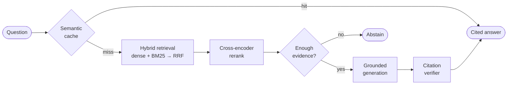

  
  
  

## 🧠 About me

I'm an AI Engineer. I build retrieval and agent systems and I care most about one question: **how do you know it works?** So every quality claim on this page comes from a versioned dataset, and every change is checked with a paired comparison before it ships.

- 🚀 **Shipped** [Personal Knowledge OS](https://github.com/yashbhosale789/Personal-Knowledge-RAG): a production RAG system, live on AWS on a $0 budget, with CI/CD, tracing, SLOs and alerting.
- 📏 **Wrote** [rag-eval-kit](https://github.com/yashbhosale789/rag-eval-kit) so any RAG system can be scored the same way: retrieval metrics, a calibrated LLM judge and paired statistics.
- 🧪 **Benchmarked** four RAG designs on one corpus and one question set in [rag-benchmarks](https://github.com/yashbhosale789/rag-benchmarks).
- 🤖 **Building** LangGraph agents with corrective retrieval, graders, knowledge-graph expansion and guardrails.

## 🚀 Featured work

<table>
  <tr>
    <td width="50%" valign="top">
      <h3>🧠 <a href="https://github.com/yashbhosale789/Personal-Knowledge-RAG">Personal Knowledge OS</a></h3>
      
<strong>Production RAG: a cited answer, or an honest "the documents don't say".</strong>

      

        
        
        
      

      <ul>
        <li>Dense + BM25 retrieval, reciprocal rank fusion, cross-encoder reranking: <strong>Recall@3 0.88, MRR 0.83</strong> on 236 PDFs</li>
        <li>A sufficiency gate abstains when the evidence is missing; a second model family verifies every citation</li>
        <li>Redis semantic cache, streamed answers (SSE), React + TypeScript UI</li>
        <li>Runs on a 2 GiB AWS EC2 instance: deploy on merge with health checks and automatic rollback, Prometheus + Grafana SLOs, Langfuse traces, an LLM-judge regression gate in CI</li>
      </ul>
      
<code>FastAPI</code> <code>ChromaDB</code> <code>Redis</code> <code>React</code> <code>Docker</code> <code>AWS</code> <code>GitHub Actions</code>

    </td>
    <td width="50%" valign="top">
      <h3>📏 <a href="https://github.com/yashbhosale789/rag-eval-kit">rag-eval-kit</a></h3>
      
<strong>Measure any RAG system through a small adapter.</strong>

      

        
        
      

      <ul>
        <li>Two methods, <code>retrieve()</code> and <code>answer()</code>, are all the kit needs to know about your system</li>
        <li>Recall@k, success@k and MRR with no LLM calls; an LLM judge for faithfulness, correctness and relevancy, with a calibration check for the judge itself</li>
        <li><code>compare</code> runs a paired bootstrap CI and a sign test, so you can tell a real gain from noise</li>
        <li><code>gate</code> fails CI on a regression; runs resume where they stopped, which suits free-tier quotas</li>
      </ul>
      
<code>Python</code> <code>CLI</code> <code>dependency-free core</code> <code>any OpenAI-compatible judge</code>

    </td>
  </tr>
  <tr>
    <td width="50%" valign="top">
      <h3>🖼️ <a href="https://github.com/yashbhosale789/multimodal-rag">multimodal-rag</a></h3>
      
<strong>An agentic chatbot that reads charts and follows facts across documents.</strong>

      <ul>
        <li>A vision model transcribes every chart and diagram, so numbers that only exist as a bar in a chart are answerable</li>
        <li>Neo4j knowledge graph with one-hop expansion: multi-hop questions went from 0/2 to 2/2 on its answer key</li>
        <li>LangGraph corrective loop: grade the hits, then rewrite, search the web or answer from model knowledge</li>
        <li>Prompt-injection guard, PII masking, audit log, Langfuse tracing</li>
      </ul>
      
<code>LangGraph</code> <code>Pinecone</code> <code>Neo4j</code> <code>Gemini</code> <code>FastAPI</code> <code>Streamlit</code> <code>Docker</code>

    </td>
    <td width="50%" valign="top">
      <h3>🤖 <a href="https://github.com/yashbhosale789/agentic-rag">agentic-rag</a></h3>
      
<strong>A LangGraph ReAct agent that writes its own searches.</strong>

      <ul>
        <li>Built as an explicit state graph: <code>agent → tools → grade → agent</code></li>
        <li>A grader checks each retrieval and sends the agent back to search again when the chunks miss (corrective RAG)</li>
        <li>Bounded to 6 steps; graph routing is tested with a stubbed LLM, no API key needed</li>
      </ul>
      
<code>LangGraph</code> <code>LangChain</code> <code>Groq</code> <code>ChromaDB</code> <code>BM25</code>

      
Part of a ladder of variants: <a href="https://github.com/yashbhosale789/naive-rag">naive-rag</a> → <a href="https://github.com/yashbhosale789/advanced-rag">advanced-rag</a> → agentic-rag → Personal Knowledge OS.

    </td>
  </tr>
</table>

## 📊 Measured, not claimed

Four RAG designs, one corpus (236 PDFs), one set of 71 labelled questions, one code path ([rag-eval-kit](https://github.com/yashbhosale789/rag-eval-kit)):

| Variant | Retrieval | Recall@3 | MRR |
| --- | --- | :---: | :---: |
| [Naive RAG](https://github.com/yashbhosale789/naive-rag) | dense top-k | 0.655 | 0.594 |
| [Advanced RAG](https://github.com/yashbhosale789/advanced-rag) | dense + BM25 → RRF → cross-encoder rerank | 0.742 | 0.735 |
| [Agentic RAG](https://github.com/yashbhosale789/agentic-rag) (retrieve tool) | same pipeline, called by an agent | 0.742 | 0.735 |
| [Production RAG](https://github.com/yashbhosale789/Personal-Knowledge-RAG) | + LLM query rewrite, larger chunks, top 3 | **0.876** | **0.829** |

Production's Recall@3 gain over Advanced holds up under a paired bootstrap and a sign test. The run files, the settings that differ and the differences that did *not* hold up are in [rag-benchmarks](https://github.com/yashbhosale789/rag-benchmarks).

<strong>How the production pipeline answers a question</strong>

## 🛠️ Tech stack

### Languages

  
  
  
  
  

### LLM and agent frameworks

  
  
  
  
  
  

### Model providers and local inference

  
  
  
  
  

### Retrieval, vector and graph stores

  
  
  
  
  
  
  
  

### Evaluation, testing and observability

  
  
  
  
  
  
  

### Backend and frontend

  
  
  
  
  
  

### Cloud and DevOps

  
  
  
  
  
  
  
  

### Machine learning and computer vision

  
  
  
  
  
  
  

| Area | What I work with |
| --- | --- |
| **Retrieval** | Hybrid dense + sparse search, reciprocal rank fusion, cross-encoder reranking, query rewriting, semantic caching, knowledge-graph expansion |
| **Generation** | Grounded answers with citations, sufficiency gating and abstention, citation verification by a second model, provider fallback chains, streaming |
| **Agents** | LangGraph state graphs, ReAct, corrective RAG with graders, tool design, MCP |
| **Evaluation** | Golden datasets, recall@k and MRR, calibrated LLM judges, paired bootstrap confidence intervals, sign tests, regression gates in CI |
| **Safety** | Prompt-injection scanning, PII masking, audit logs, rate limiting |
| **Operations** | Deploy on merge with health checks and rollback, SLOs with burn-rate alerts, request tracing, container image scanning |

## 📈 GitHub activity

  

  

  

  

  <picture>
    <source media="(prefers-color-scheme: dark)" srcset="https://raw.githubusercontent.com/yashbhosale789/yashbhosale789/output/github-contribution-grid-snake-dark.svg" />
    <source media="(prefers-color-scheme: light)" srcset="https://raw.githubusercontent.com/yashbhosale789/yashbhosale789/output/github-contribution-grid-snake.svg" />
    
  </picture>

